# 流光绘影：FPGA 实时视频风格化系统

本项目运行于 Ti60F225 开发板，使用 SC431HAI CSI 摄像头采集图像，经 FPGA 处理后输出至 HDMI 显示屏。工程包含五种神经网络风格、独立 Sobel 线条 Demo，以及从板载 Flash 加载程序和模型的开机自启动实现。

## 实机效果

摄像头采集、FPGA 风格化、HDMI 输出。以下 15 张五风格实拍按场景分组，展示副本裁去屏幕上方的面板留白，保留完整屏幕、原图对照和风格名称；点击图片可查看未裁剪原照。

[现实人物 · 5 张](#现实人物) · [手机人物 · 7 张](#手机人物) · [风景 · 3 张](#风景) · [基础线稿 Demo](#基础线稿-demo)

### 现实人物

同一室内场景，呈现五种风格下的人物、衣物与背景。

<table>
<tr>
<td width="50%" align="center" valign="middle" rowspan="2">
<a href="docs/gallery/originals/real-people/display-10.jpg">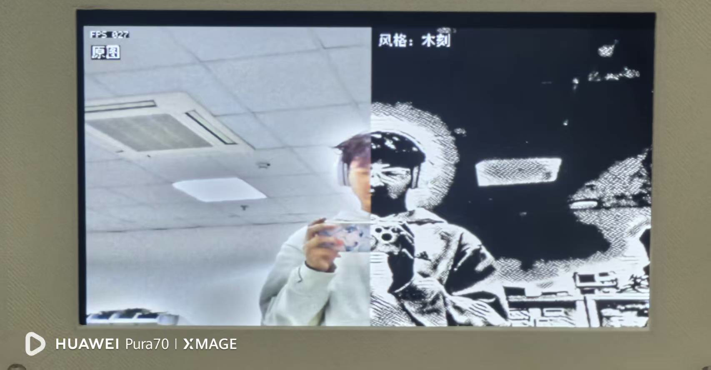</a><br>
<strong>木刻</strong>
</td>
<td width="25%" align="center" valign="middle">
<a href="docs/gallery/originals/real-people/display-11.jpg">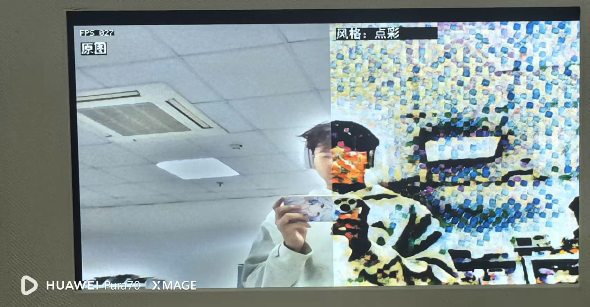</a><br>
<strong>点彩</strong>
</td>
<td width="25%" align="center" valign="middle">
<a href="docs/gallery/originals/real-people/display-08.jpg">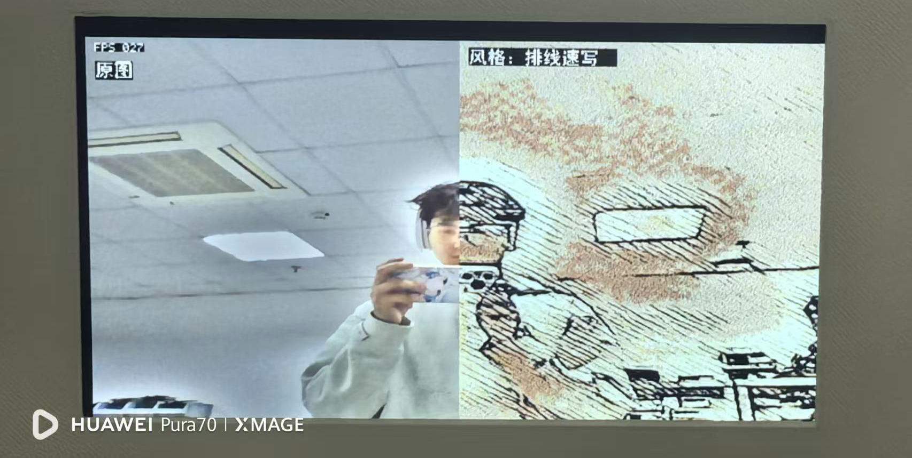</a><br>
<strong>排线速写</strong>
</td>
</tr>
<tr>
<td width="25%" align="center" valign="middle">
<a href="docs/gallery/originals/real-people/display-12.jpg">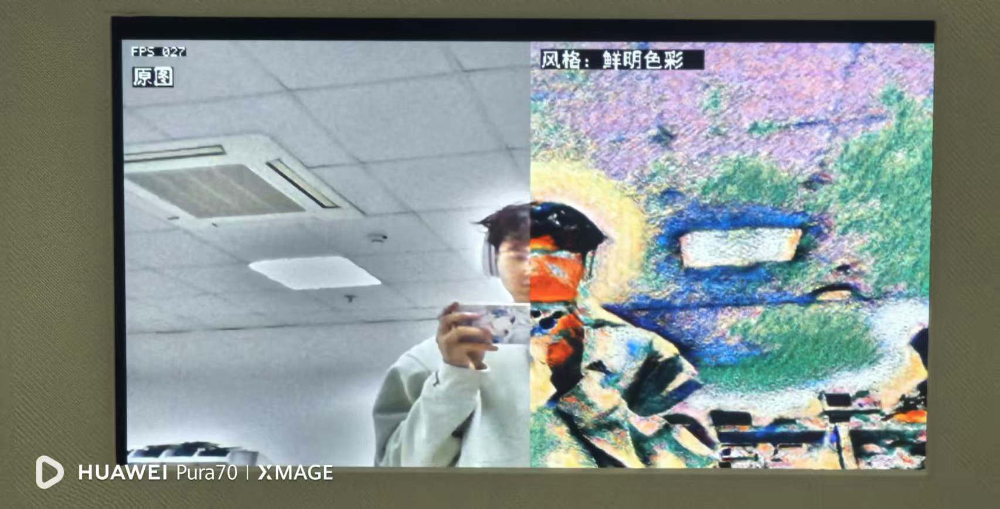</a><br>
<strong>鲜明色彩</strong>
</td>
<td width="25%" align="center" valign="middle">
<a href="docs/gallery/originals/real-people/display-09.jpg">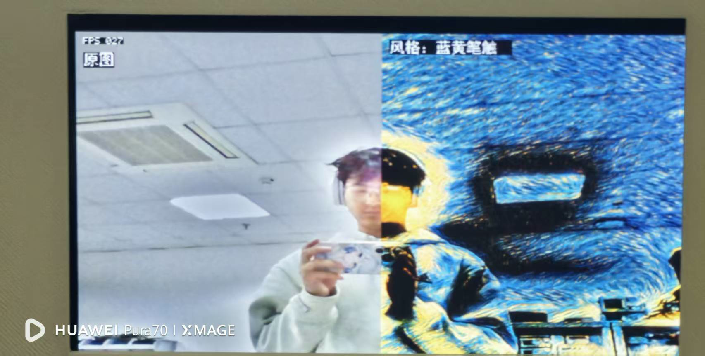</a><br>
<strong>蓝黄笔触</strong>
</td>
</tr>
</table>

### 手机人物

以手机中的人物画面作为拍摄对象，展示五种风格及不同构图下的木刻效果。

<table>
<tr>
<td width="100%" align="center" valign="middle" colspan="2">
<a href="docs/gallery/originals/phone-portraits/display-02.jpg">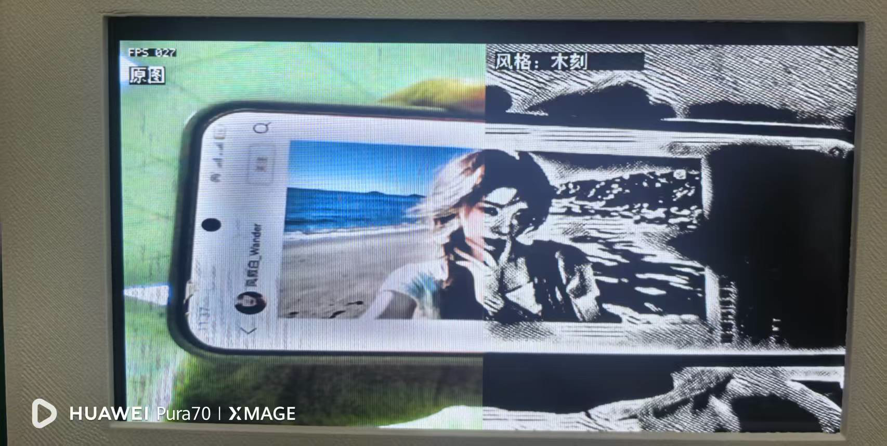</a><br>
<strong>木刻 · 横屏画面</strong>
</td>
</tr>
<tr>
<td width="50%" align="center" valign="middle">
<a href="docs/gallery/originals/phone-portraits/display-04.jpg">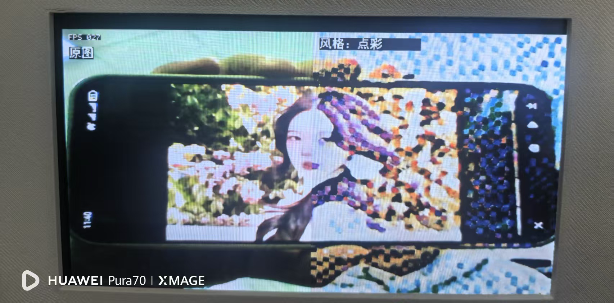</a><br>
<strong>点彩</strong>
</td>
<td width="50%" align="center" valign="middle">
<a href="docs/gallery/originals/phone-portraits/display-01.jpg">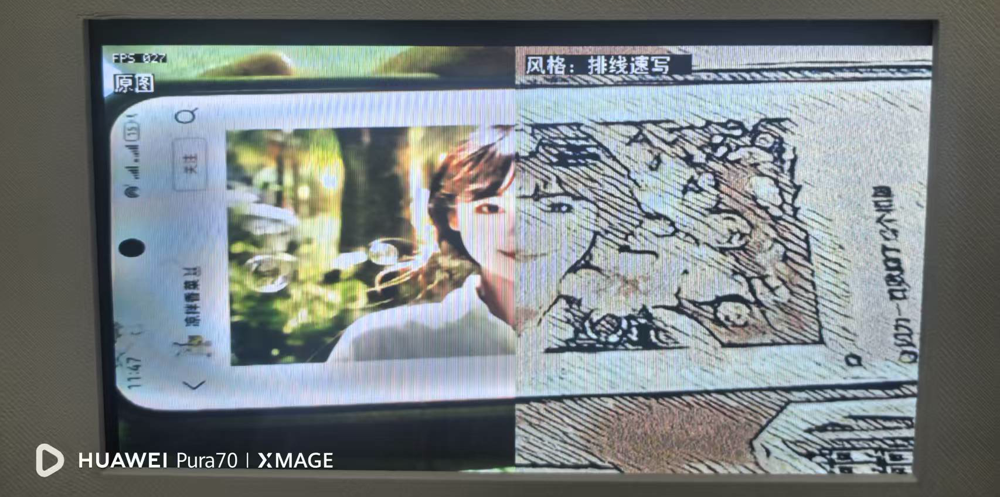</a><br>
<strong>排线速写</strong>
</td>
</tr>
<tr>
<td width="50%" align="center" valign="middle">
<a href="docs/gallery/originals/phone-portraits/display-06.jpg">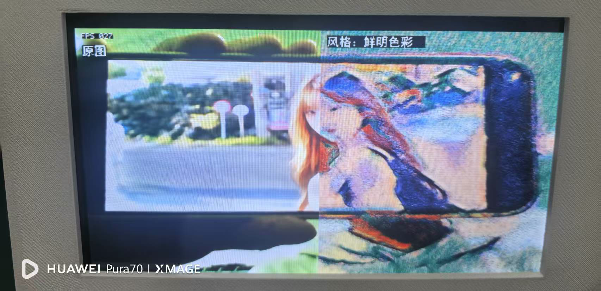</a><br>
<strong>鲜明色彩</strong>
</td>
<td width="50%" align="center" valign="middle">
<a href="docs/gallery/originals/phone-portraits/display-07.jpg">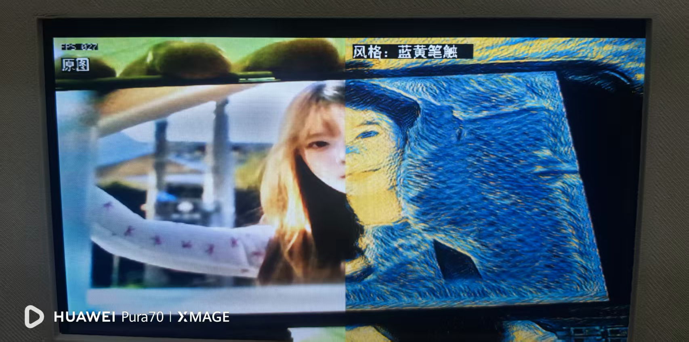</a><br>
<strong>蓝黄笔触</strong>
</td>
</tr>
<tr>
<td width="50%" align="center" valign="middle">
<a href="docs/gallery/originals/phone-portraits/display-03.jpg">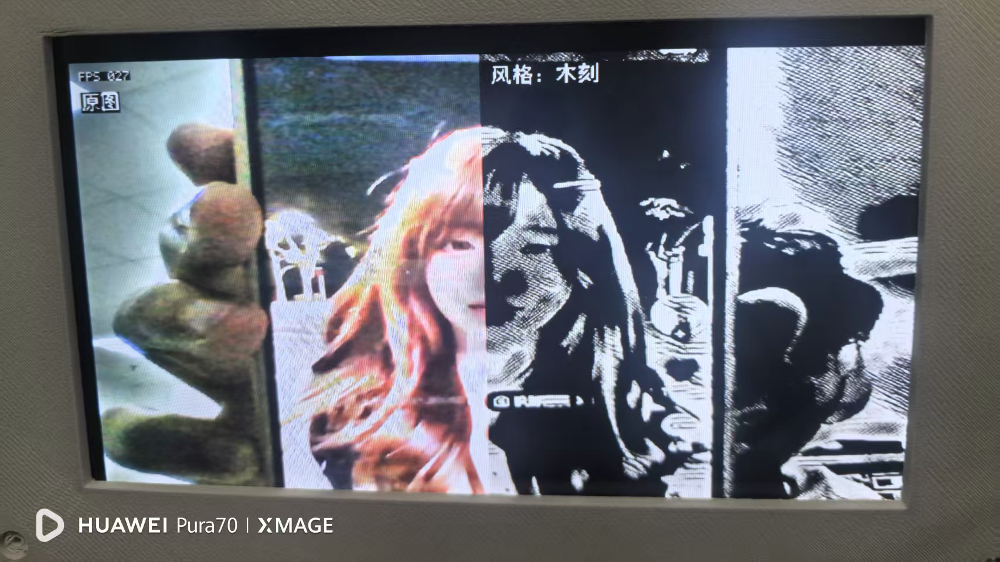</a><br>
<strong>木刻 · 人物近景</strong>
</td>
<td width="50%" align="center" valign="middle">
<a href="docs/gallery/originals/phone-portraits/display-05.jpg">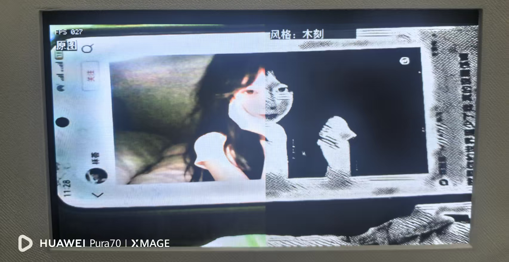</a><br>
<strong>木刻 · 不同构图</strong>
</td>
</tr>
</table>

### 风景

山体与树林的色彩、纹理和轮廓，在蓝黄笔触与排线速写中呈现不同效果。

<table>
<tr>
<td width="67%" align="center" valign="middle" rowspan="2">
<a href="docs/gallery/originals/landscapes/display-13.jpg">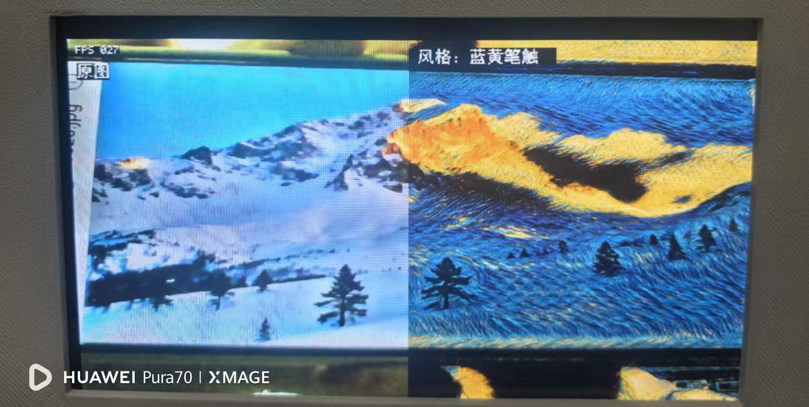</a><br>
<strong>蓝黄笔触 · 山景</strong>
</td>
<td width="33%" align="center" valign="middle">
<a href="docs/gallery/originals/landscapes/display-15.jpg">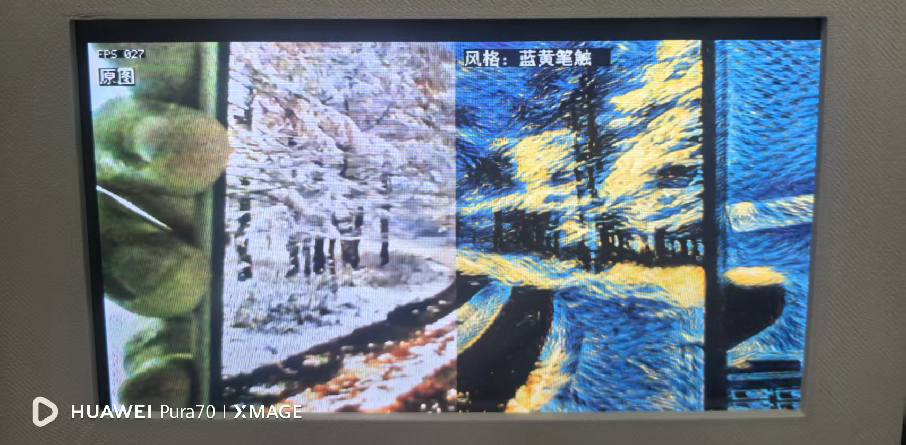</a><br>
<strong>蓝黄笔触 · 树林</strong>
</td>
</tr>
<tr>
<td width="33%" align="center" valign="middle">
<a href="docs/gallery/originals/landscapes/display-14.jpg">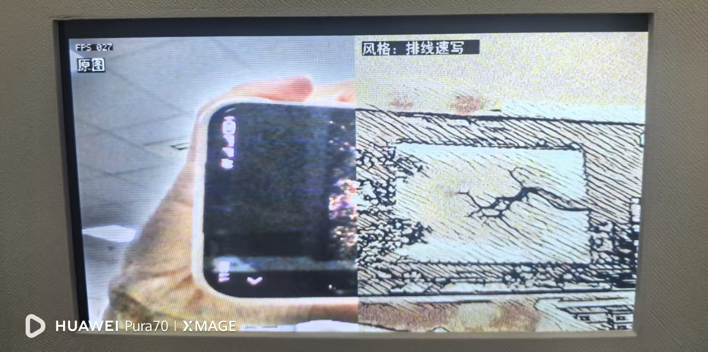</a><br>
<strong>排线速写</strong>
</td>
</tr>
</table>

[浏览全部原始照片与分组索引](docs/gallery/README.md)

### 基础线稿 Demo

独立 Sobel 工程将摄像头画面转换为黑白线稿，以 640×480 分辨率输出至 HDMI 显示屏。源码与运行方法见 [线条 Demo](line-demo/README.md)。

<p align="center">
<a href="docs/gallery/originals/line-demo/line-art.jpg">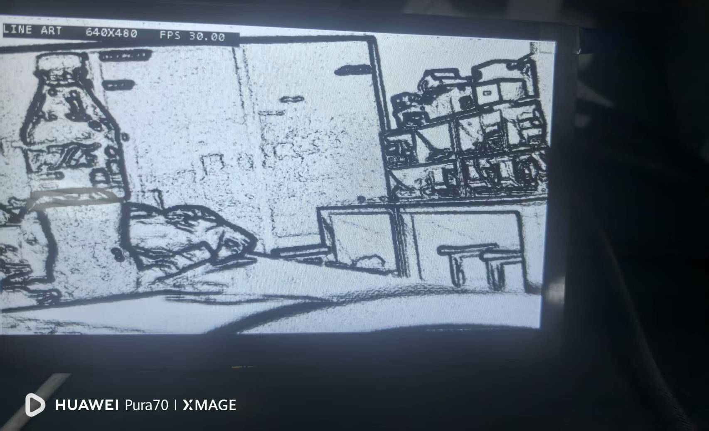</a><br>
<strong>基础线稿 Demo · 实机效果</strong>
</p>

## 外壳与机械设计

两套外壳均由团队自主建模并采用 3D 打印制作。第一套将摄像头与屏幕布置在同侧；第二套将摄像头与屏幕分置两面。外壳使用 ABS、PLA Basic、PETG 等材料，整机由充电宝供电。

### 两套实物

<table>
<tr>
<td width="50%" align="center" valign="middle">
<a href="docs/enclosures/originals/same-side/A01.jpg">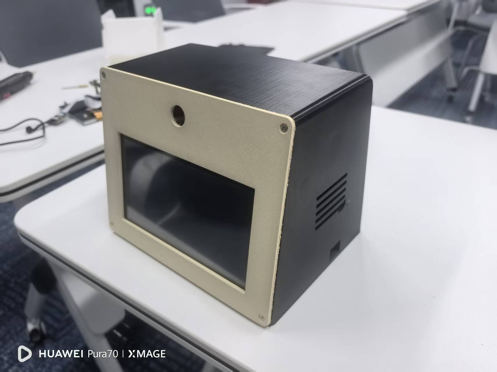</a><br>
<strong>第一套 · 整机外观</strong>
</td>
<td width="50%" align="center" valign="middle">
<a href="docs/enclosures/originals/opposite-side/B02.jpg">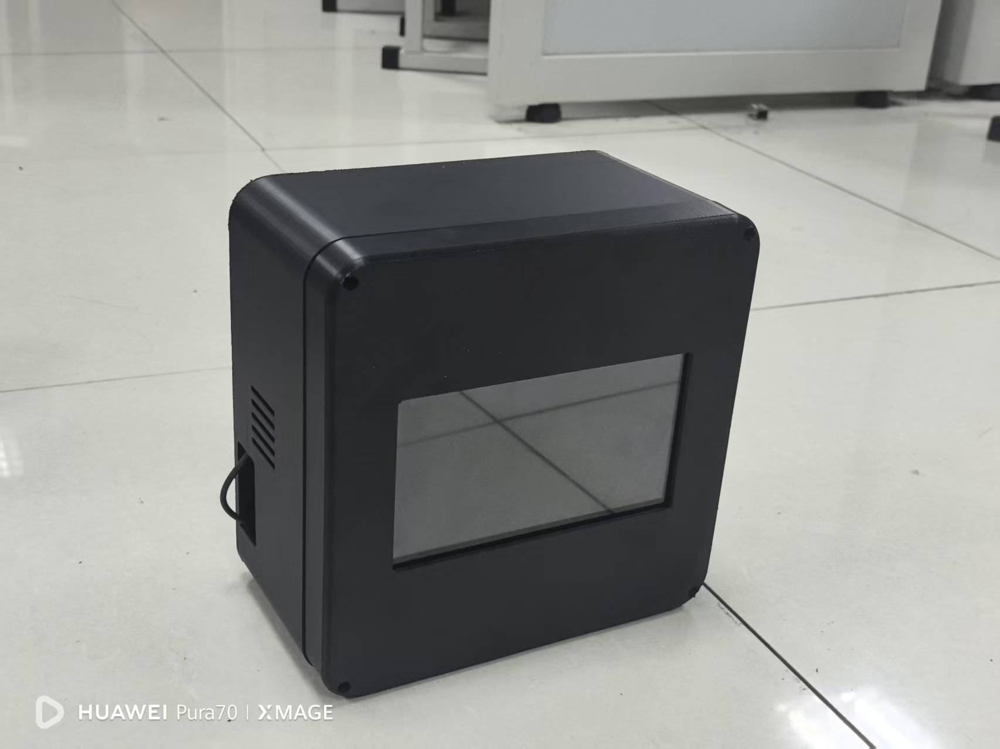</a><br>
<strong>第二套 · 屏幕面外观</strong>
</td>
</tr>
</table>

### 三维装配与分解图

<table>
<tr>
<td width="50%" align="center" valign="middle">
<a href="docs/enclosures/originals/same-side/A02.png">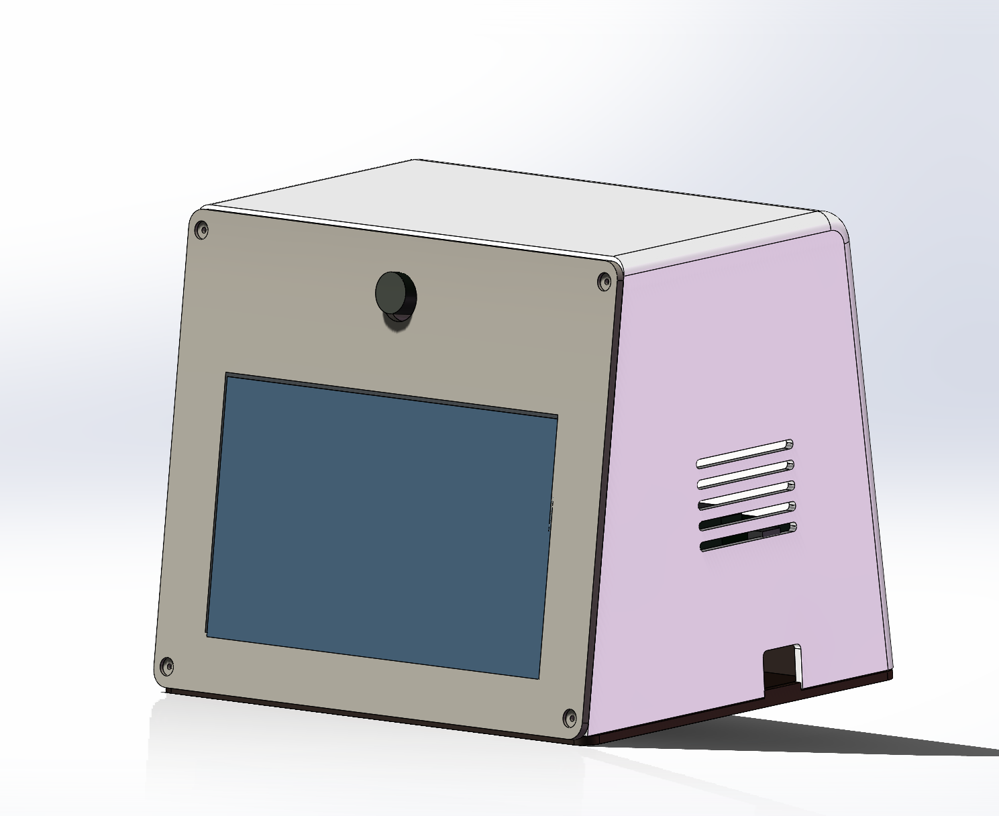</a><br>
<strong>第一套 · 整体装配模型</strong>
</td>
<td width="50%" align="center" valign="middle">
<a href="docs/enclosures/originals/same-side/A09.png">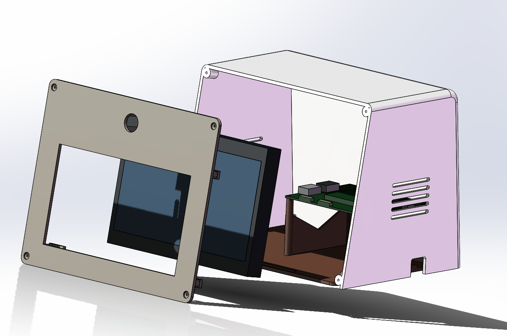</a><br>
<strong>第一套 · 分解模型</strong>
</td>
</tr>
<tr>
<td width="50%" align="center" valign="middle">
<a href="docs/enclosures/originals/opposite-side/B07.png">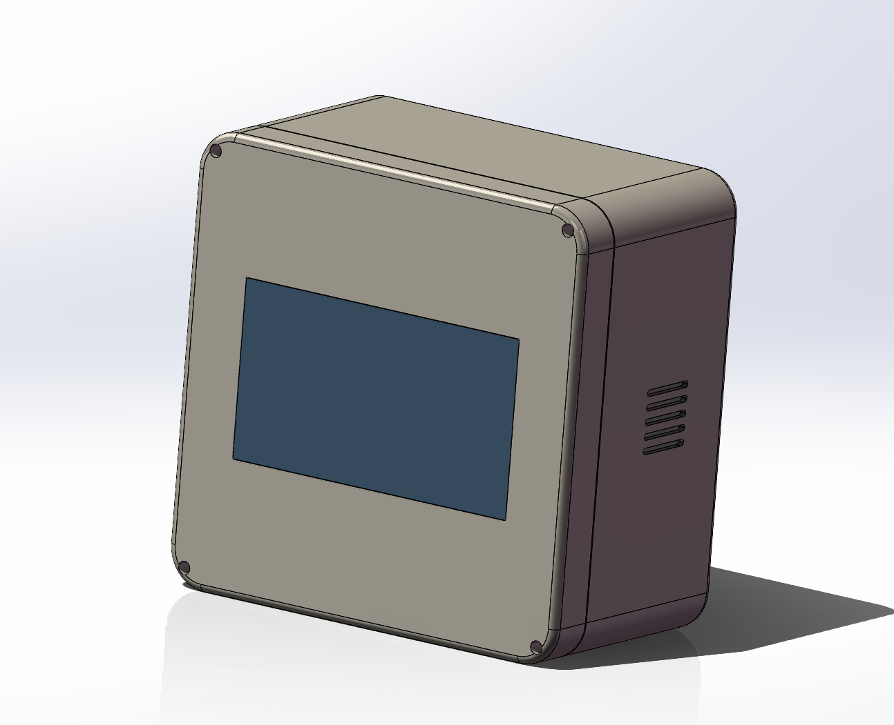</a><br>
<strong>第二套 · 整体装配模型</strong>
</td>
<td width="50%" align="center" valign="middle">
<a href="docs/enclosures/originals/opposite-side/B05.png">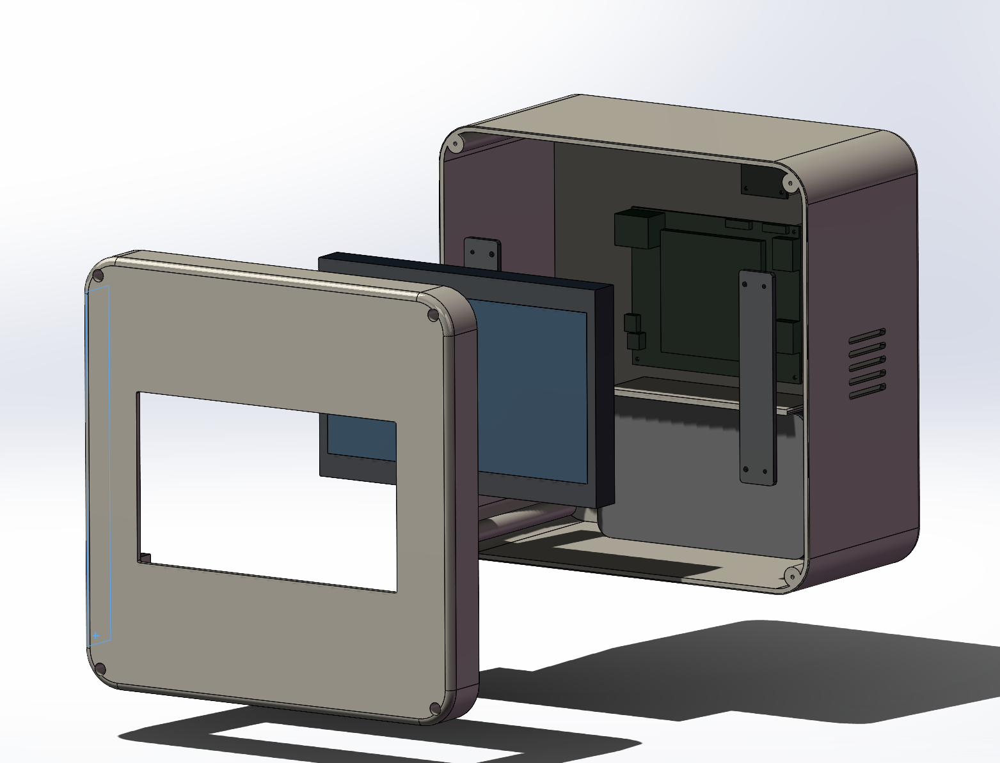</a><br>
<strong>第二套 · 分解模型</strong>
</td>
</tr>
</table>

[查看全部 12 张实物照片与 4 张机械设计图](docs/enclosures/README.md)

## 功能与工程入口

| 工程 | 功能 | 源码目录 | 加载命令 |
|---|---|---|---|
| 五风格主工程（fit34） | 原图／风格图左右对照，手势切换，Bayer 彩点修正与自动曝光 | `fpga/`、`firmware/` | `./load.ps1 -Target main` |
| 独立线条 Demo（Sobel v2） | 640×480 线条提取、原图旁路、单行信息显示 | `line-demo/` | `./load.ps1 -Target line` |
| 五风格自启动工程（fit32） | 上电加载片内固件，从 Flash 读取模型并校验 CRC，然后运行摄像头与五风格处理 | `autoboot/` | `./load.ps1 -Target autoboot` |

主工程与自启动工程是两个独立构建：fit34 包含自动曝光，fit32 使用固定曝光。各自的位流、固件和源码对应关系由校验清单固定。`load.ps1` 用于 JTAG 运行；开机自启动的 Flash 烧录方法见 [自启动说明](autoboot/README.md)。

屏幕右侧的五种风格名称及切换顺序为：**木刻 → 点彩 → 排线速写 → 鲜明色彩 → 蓝黄笔触**。左侧显示“原图”。在镜头前水平挥手可切换风格；保持摄像头固定，连续动作之间稍作停顿。模型对应关系见 [模型说明](models/README.md)。独立线条 Demo 显示 `LINE ART`，与五风格中的“排线速写”分别实现。

## 硬件与开发环境

- Ti60F225 开发板、配套 SC431HAI 摄像头、HDMI 显示屏、USB 调试线和开发板电源。
- 摄像头接开发板 CSI 接口 J4；显示屏接 HDMI TX；USB 调试接口连接电脑。
- Windows、Efinity 2025.1、Efinix RISC-V IDE 2025.1、Python 3。模型导出另需 `model-source/requirements.txt`；仿真使用 Linux/WSL 的 GCC、Icarus Verilog 和 Verilator。

## 运行与编译

在项目根目录打开 PowerShell，先运行 `python tools/verify.py` 检查文件，再执行上表中的加载命令。五风格工程需要 Flash 中已有配套模型；首次配置使用自启动说明中的模型与配置烧录流程。线条 Demo 不依赖模型。

```powershell
# 编译三个固件，输出到 build/ 对应子目录
python tools/build_firmware.py --target main
python tools/build_firmware.py --target line
python tools/build_firmware.py --target autoboot

# 修改固件后，先更新片内 RAM 初值，再编译对应 FPGA 工程
python tools/build_firmware.py --target line --update-ram
./build-fpga.ps1 -Target line
```

目标名称统一为 `main`、`line`、`autoboot`。FPGA 输出位于相应工程的 `fpga/outflow/`；`prebuilt/` 保存配套参考文件。`load.ps1` 加载的是参考文件。工具安装位置不同，可指定 `-EfinityHome`、`-RiscvSdk` 或 `--toolchain`。

## 其他源码与验证

- `models/`：部署模型；`model-source/`：模型源码、检查点与量化参数；`tools/export_models.py`：部署模型导出。
- `firmware/vendor/`：三个工程共用的 BSP、启动汇编和驱动；`tools/generate_fonts.py`：屏幕中文字模及线条 Demo 字模生成。
- `tests/`、`line-demo/tests/`、`autoboot/tests/`：算法、显示、采集与启动测试。运行方法见 [测试说明](tests/README.md)。
- `manifest.json`：整包 SHA-256；各工程的 `source-manifest.json`：源码与参考位流、ELF 的对应关系。

厂商 IP 和模型代码保留各自的版权与许可。
