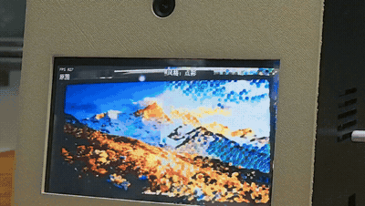
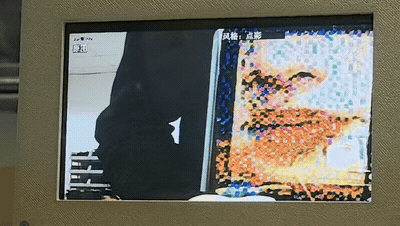
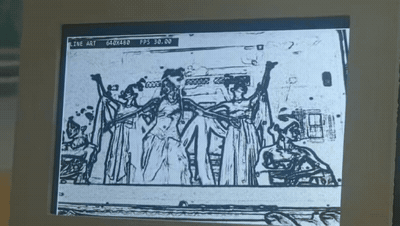
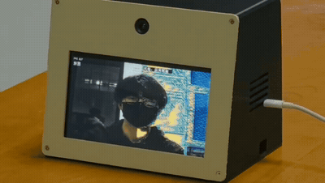

# 实机演示视频

四段实机视频展示五种风格的场景与人物效果、独立线条处理和手势切换。点击动图查看完整视频；场景与人物动图为片段预览。

<table>
<tr>
<td width="50%" align="center" valign="top">
 
<strong>五种风格 · 场景混剪</strong> 
<a href="originals/five-style-scenes-20261104.mp4">完整视频 · 1:48</a>
</td>
<td width="50%" align="center" valign="top">
 
<strong>五种风格 · 人物混剪</strong> 
<a href="videos/five-style-portraits-20261104.mp4">完整视频 · 0:49</a>
</td>
</tr>
<tr>
<td width="50%" align="center" valign="top">
 
<strong>独立线条测试 Demo</strong> 
<a href="videos/line-demo-20261104.mp4">完整视频 · 0:12</a>
</td>
<td width="50%" align="center" valign="top">
 
<strong>手势切换演示</strong> 
<a href="videos/gesture-switch-20261104.mp4">完整视频 · 0:24</a>
</td>
</tr>
</table>

| 视频 | 时长 | 完整视频 | 原始文件 |
|---|---|---|---|
| 五种风格 · 场景混剪 | 1:48 | [观看／下载](originals/five-style-scenes-20261104.mp4) | [原视频](originals/five-style-scenes-20261104.mp4) |
| 五种风格 · 人物混剪 | 0:49 | [观看／下载](videos/five-style-portraits-20261104.mp4) | [原视频](originals/five-style-portraits-20261104.mp4) |
| 独立线条测试 Demo | 0:12 | [观看／下载](videos/line-demo-20261104.mp4) | [原视频](originals/line-demo-20261104.mp4) |
| 手势切换演示 | 0:24 | [观看／下载](videos/gesture-switch-20261104.mp4) | [原视频](originals/gesture-switch-20261104.mp4) |

四段原视频均保持原始文件内容。完整播放版本保留全部时长与声音，动图用于无声预览。文件名对应关系和 SHA-256 见 [视频索引](index.json)。
